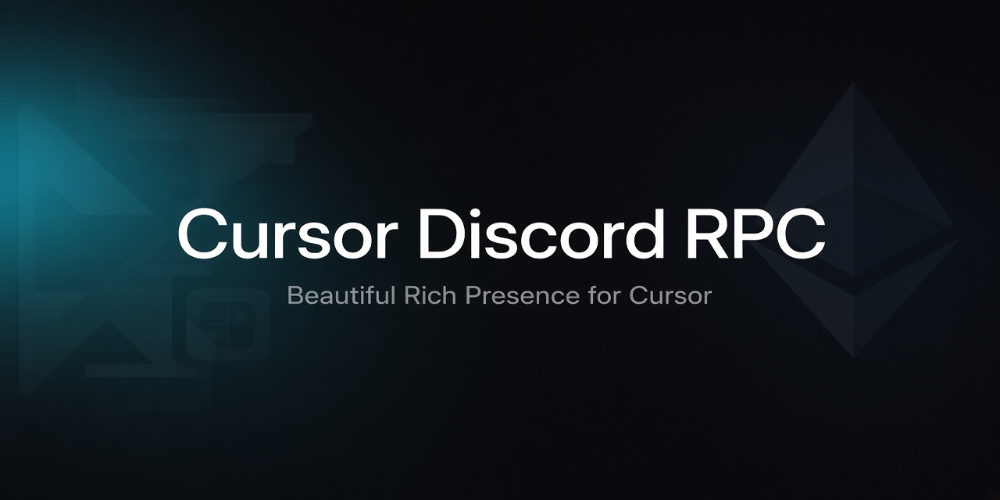

<p align="center">
  
</p>

<h1 align="center">Cursor Discord RPC</h1>

<p align="center">
  Красивый Discord Rich Presence для <b>Cursor IDE</b> — одним EXE, с тёмным интерфейсом настроек.
</p>

<p align="center">
  
  
  
</p>

---

## Что умеет

- Показывает в Discord, что ты делаешь в Cursor: **редактирует файл**, **пишет код**, **чат с AI**, и т.д.
- Можно включить/выключить: активность, файл, проект, **название чата**, таймер сессии
- Кнопка на репозиторий — **добавить или убрать** из интерфейса
- Автозапуск вместе с Windows (удобно держать рядом с Cursor)
- Presence только пока Cursor запущен
- Системный трей + красивое окно настроек
- Собирается в **один EXE**

## Быстрый старт

### 1. Discord Application

По умолчанию используется приложение автора (`1562085628630540318`).  
Свой Client ID можно вписать в настройках в любой момент.

*(Опционально для своей app)* [Developer Portal](https://discord.com/developers/applications) → Rich Presence → Art Assets → ключ `cursor`.

### 2. Запуск

**Готовый EXE** (после сборки):

```text
dist\CursorDiscordRPC.exe
```

Или из исходников:

```bash
pip install -r requirements.txt
python run.py
```

### 3. Автозапуск

В интерфейсе включи **«Автозапуск с Windows / Cursor»** — ярлык появится в Startup.  
Приложение сидит в трее; ПКМ → «Открыть настройки».

## Сборка одного EXE

```powershell
.\scripts\build_exe.ps1
```

Результат: `dist\CursorDiscordRPC.exe`

## Настройки

| Опция | Описание |
|--------|----------|
| Активность | Авто из Cursor или пресеты / свой текст |
| Файл / проект / чат | Что писать во второй строке Presence |
| Кнопка | Label + URL (по умолчанию этот репозиторий) |
| Client ID | По умолчанию app автора; можно заменить на свой |

Конфиг лежит в `%USERPROFILE%\.cursor-discord-rpc\config.json`.

## Стек

- Python 3.12 · CustomTkinter · pypresence · pystray · PyInstaller

## Лицензия

MIT
